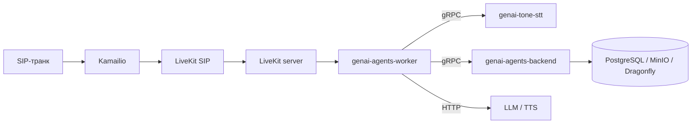

# GenAI VoiceBot

Короткая карта репозиториев: кто за что отвечает.

## Как проходит звонок

## Репозитории

**`genai-agents-worker`** — ведёт звонок: распознавание → LLM → синтез, сценарий открытия,
инструменты, запись, метрики.

**`genai-agents-backend`** — конфиг агентов, провайдеров и кампаний, приём результатов звонков,
LLM-анализ и скоринг, отчёты и веб-интерфейс.

**`genai-tone-stt`** — ASR по gRPC, несколько реплик за воркерами.

**`genai-deployment`** — только compose и `make`: базы, брокер, LiveKit, Kamailio, Traefik,
наблюдаемость.

**`genai-contracts`** — proto и биндинги Python/Go. Меняется только здесь, сервисы пиннят commit SHA,
не ветку.

**`genai-prompt-tester`** — прогон одного промпта на фиксированных кейсах и сравнение двух прогонов.

**`genai-scripts`** — офлайн-скоринг выгрузок звонков и сравнение воронок. В проде не крутится.

**`genai-testing`** — нагрузочные тесты SIP и проверки ASR. В проде не крутится.

**`genai-oncall`** — дежурство: runbook на каждый симптом, скрипты диагностики и доступы к
наблюдаемости. Доступ только для членов организации. С него начинается любой разбор бага.

## Ветки и релиз

1. Ветка от `dev` (в `genai-contracts` и `genai-prompt-tester` — от `main`).
2. PR в `dev`.
3. Релиз — отдельный PR `dev -> main: <что поменялось>`.
4. В прод идёт только смерженный `main`, через `deploy-prod`.

## Если что-то сломалось

Внутри организации есть репозиторий `genai-oncall`: доступы, runbook на каждый симптом и
read-only скрипты диагностики — с него начинается разбор. Grafana показывает метрики и логи,
GlitchTip — исключения, алерты приходят в Telegram. Нужен доступ — напишите инфраструктурной
команде.
